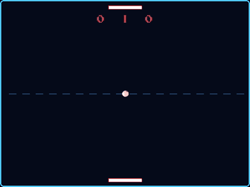
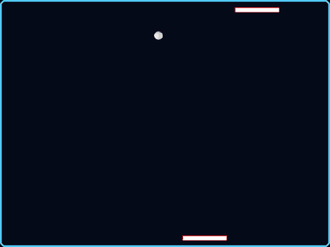
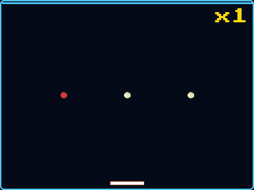
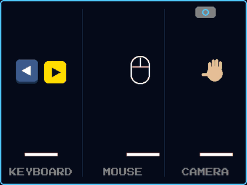
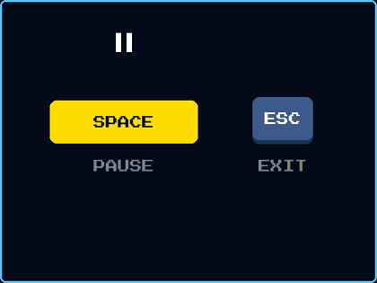

# special-space-pong
Motion-controlled Pong built with Python &amp; OpenCV — hand tracking via optical flow, with procedural levels, i18n, and an adaptive AI opponent.

## How to play

| | |
|---|---|
|  | **Campaign** Win 5 levels against an opponent. Each one adds something new: asteroids, more balls... and there is a secret level. |
|  | **Edge shot** Hit the ball with the edge of the paddle: it flies off at an angle and faster. |
|  | **Survival** No opponent: return every ball. Only the red one costs lives, and it keeps passing to another ball. |
|  | **Controls** Arrow keys, mouse, or your hand in front of the webcam. |
|  | **Keys** SPACE pauses, ESC goes back to the menu. |

# generate GIFs

python -m pip install -r requirements-dev.txt
python tools/record_demos.py
python tools/record_demos.py --width 360 --fps 12 --lang es

# test

python -m pytest